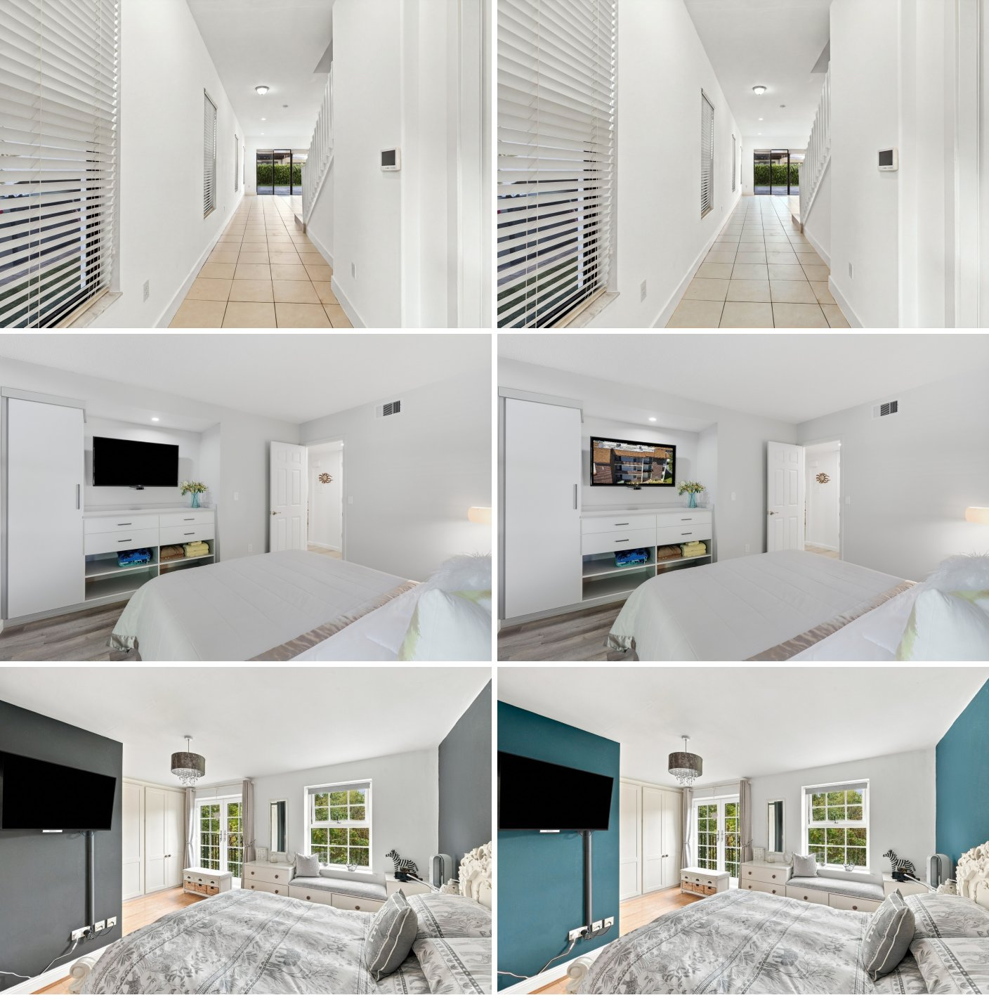
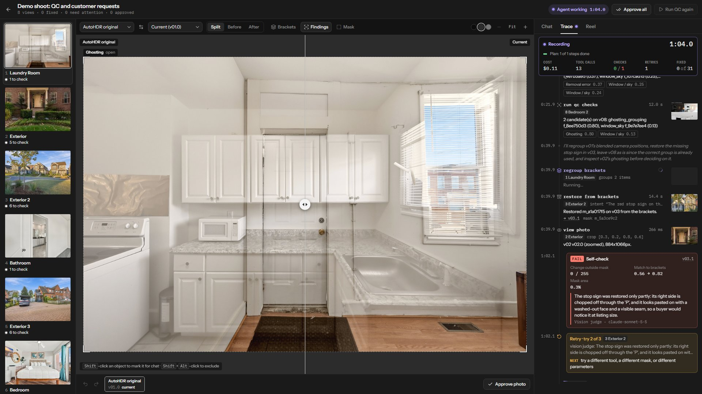
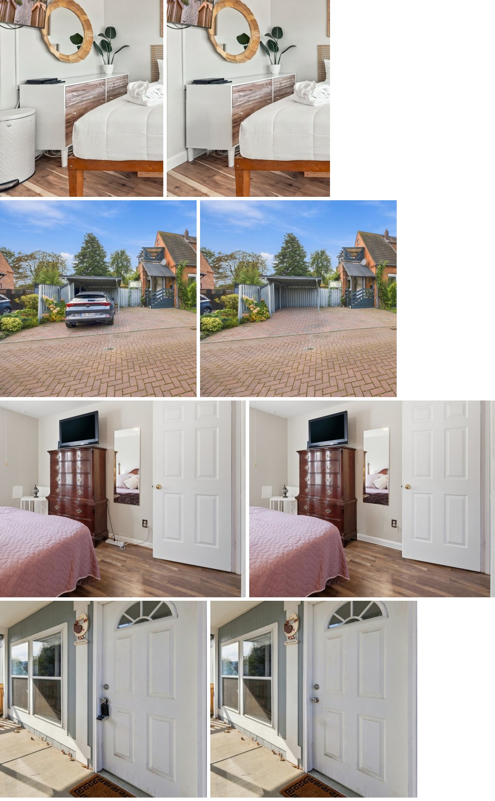
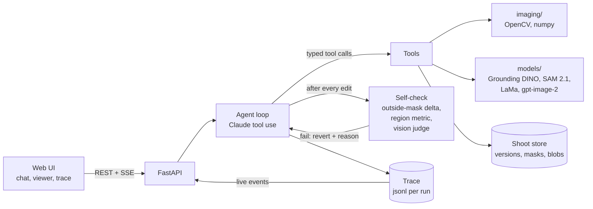

# ShootAgent

ShootAgent checks a real-estate photo shoot against the camera's own exposure brackets, fixes what the
editing pipeline got wrong, applies a customer's chat requests across every photo they concern, and cuts
a 9:16 listing reel from the approved photos. Every decision it makes shows up in a live trace: the
plan, each tool call, each self-check, and each retry.

Built for the AITX & MLOps World Community Hackathon (Austin Tech Week, October 2026), entering the
AutoHDR "Image Models & Pipelines" track (conversational editing, with AI quality control as the
agent's first pass) and the Antler "Agents" track.



*Three real saved customer requests from AutoHDR's editor dataset, applied from chat. Top: "Please use
#C8C2B7 color for floors". Middle: "Add the reference image on the TV screen". Bottom: "change the grey
walls to the colour in the reference image". Pixels outside each edit are byte-identical to the
delivered photo.*

## What it does

**QC pass.** For each view, ShootAgent aligns and fuses the brackets into a reference, then compares the
finished photo with it. Wrong bracket groups, ghosting, objects erased by mistake, fire painted onto the
wrong object and wall colour that drifted all show up as disagreement between the two. Claude looks at
each candidate's finished and bracket crops side by side and decides whether it is a defect or a
legitimate edit, such as a sky replacement or a blacked-out TV. It then fixes real defects with tools:
restore the region from the brackets, recolour to the bracket's hue, or split the brackets into separate
views and fuse each one.

**Chat pass.** A customer types "remove the cars" or "use #C8C2B7 for the floors". The agent looks at the
whole shoot, decides per photo whether the request applies, finds the region with Grounding DINO and
SAM 2.1, edits, and reports each photo as applied, not needed (with the reason), or failed.



*A live QC run in the workspace: photos on the left, before/after in the middle, and the trace on the
right with the plan, tool calls, a failed self-check and its retry.*

**Self-check and retry.** The loop, not the model, runs a check after every edit. It measures the change
outside the mask (it must be zero), measures region targets such as delta-E to a hex colour or the EV
change, and asks a Claude vision judge to compare before and after against the stated intent. A failed
check moves the photo back to its previous version and returns the reason, and the agent must try a
different tool or mask. In one run the judge rejected two wire removals because they also erased the
wall outlet the customer wanted kept; the third attempt kept it.

**Listing reel.** The agent labels rooms, orders photos the way a listing agent walks a buyer through
a home, picks a camera move and focus point per photo, renders, and checks a strip of frames before it
finishes. The music is generated, so the reel carries no licence.



*Removals from saved customer requests: a trash bin, a car, wires and an extension cord, a lockbox.*

## Results

Measured on this repository's code, an RTX 4060 laptop, Claude Sonnet 5.5 for the agent and the judge,
and gpt-image-2 for fills. Costs are estimates from token counts at list prices. Raw outputs are in
[docs/eval](docs/eval).

**QC pass, full agent, all 63 AutoHDR defect cases** (`eval/agent_qc.py`, 8 shoots of 8 views, one run
each). "Fixed" means the agent confirmed a finding of the labelled family over the labelled region and
its fix passed the self-check. "Flagged" means it confirmed the defect but left it for a human.

| Family | Cases | Fixed | Flagged | Missed |
|---|---|---|---|---|
| ghosting / grouping | 21 | 20 | 0 | 1 |
| camera, tripod, person removal | 14 | 5 | 1 | 8 |
| fireplace | 7 | 1 | 2 | 4 |
| paint colour | 6 | 4 | 0 | 2 |
| window / sky | 4 | 0 | 0 | 4 |
| lens geometry | 4 | 0 | 0 | 4 |
| floor colour | 2 | 0 | 0 | 2 |
| TV / art | 1 | 0 | 0 | 1 |
| **clean controls** | 4 | 4 kept byte-identical | | |

30 of 59 defects fixed and 3 flagged; no clean photo edited; no run crashed. 26.4 s and $0.073 per view.
The self-check failed 15 edits, all reverted; 12 retries followed. (A first run, before the paint and
fire work below, fixed 24 and flagged 2 at $0.045 per view.)

Grouping is the strongest result. The detector splits brackets into camera positions with feature
matching and matched the labelled groups on 59 of 59 cases; the agent then re-fuses each group into its
own photo. Paint colour went from 0 to 4 of 6 after adding a check that compares raw bracket colour with
the finished colour on segmented walls: the earlier global colour fit absorbed pale blue walls, so the
drift never showed. Fire depends on the order. Each case's `case.json` states what was requested
("Fire addition is disabled"), and the agent restores fire the order forbids or fire painted onto
something that is not a firebox, and leaves fire it cannot account for open for the photographer.
The deterministic detector finds 73% of all defects (`eval/qc_defects.py`, table in
[docs/eval/qc_defects.md](docs/eval/qc_defects.md)); most remaining losses are restores that fail the
vision judge (a firebox left flat black, a faded patch) and families with no check yet (sky, lens).

**Chat pass, saved customer requests** from AutoHDR's editor dataset, one view each:

| Request | Result | Attempts | Time | Cost |
|---|---|---|---|---|
| #156 "Please use #C8C2B7 color for floors" | applied | 2 | 75 s | $0.15 |
| #100 "Add the reference image on the TV screen" | applied | 2 | 29 s | $0.09 |
| #21 "change the grey walls to the colour in the reference image" | applied | 3 | 70 s | $0.20 |
| #43 "remove white trash bin on the side" | applied | 1 | 77 s | $0.10 |
| #5 "remove the grey car" | applied | 1 | 43 s | $0.08 |
| #147 "remove wires and extension cord" | applied | 3 | 134 s | $0.24 |
| #58 "remove lockbox" | applied | 1 | 44 s | $0.07 |

Pixels outside the edit region were byte-identical in every case (outside-mask delta 0). The extra
attempts are the self-check at work: the judge rejected the first floor recolour as too slight and the
first two wire removals for erasing the wall outlet. Shoot-wide edits on an 8-view shoot: a watermark on
every photo in 83 s ($0.25), and half a stop brighter in 154 s ($0.37, measured +0.50 EV per view).

**Removal quality** (`eval/models_removal.py`, 12 real photos with bins, cars and cords, one attempt
each, judged by the vision judge): gpt-image-2 with a grown, shadow-aware mask passes 10 to 11 of 12;
LaMa alone passes 2 of 12.

## Quick start

Requirements: Python 3.11 or 3.12, Node 20, ffmpeg on PATH, and [uv](https://docs.astral.sh/uv/).
An NVIDIA GPU with 8 GB runs the local models; Apple MPS and CPU work but are slower.

```bash
git clone https://github.com/SamGu-NRX/shootagent && cd shootagent
uv sync --extra local --extra dev        # torch, transformers, OpenCV, FastAPI
cp .env.example .env                     # then fill in the keys below
cd web && npm ci && npm run build && cd ..
uv run shootagent serve                  # http://127.0.0.1:8000
```

For UI development, run `uv run shootagent serve` and `cd web && npm run dev` (http://localhost:5173,
proxied to the API). The UI also has a demo mode (`?api=mock`) that replays a recorded trace with no
backend.

### Keys

| Variable | Needed for | Notes |
|---|---|---|
| `ANTHROPIC_API_KEY` | the agent loop and the vision judge | or `ANTHROPIC_BASE_URL` + `ANTHROPIC_AUTH_TOKEN` for a gateway |
| `OPENAI_API_KEY` | generative fills and removals (`gpt-image-2`) | optional: without it, removals fall back to local LaMa, which handles small objects only |
| `AUTOHDR_DEFECT_DIR`, `AUTOHDR_CUSTOMER_DIR`, `AUTOHDR_EDITOR_REQUESTS` | demo shoots and evals | paths to the unzipped datasets |
| `DEMO_PASSCODE` | a public deployment | every `/api` request then needs it |

Local model weights (Grounding DINO base, SAM 2.1 hiera-large, big-lama) download on first use, about
2 GB in total.

### Reproduce the demo

```bash
uv run shootagent demo showcase           # 4 defect cases + 4 saved customer-request photos (the live demo)
uv run shootagent demo qc-tour            # 8 defect cases: grouping, ghosting, fire, false removal, paint, 2 clean
uv run shootagent qc <shoot-id>           # autonomous QC pass, trace printed as it runs
uv run shootagent chat <shoot-id> "add a 'Listed by Acme Realty' watermark bottom-right on every photo"
```

Or open the UI, pick a demo shoot on the start screen, and press Run QC.

## How it works



The agent edits a shoot only through typed tools, and deterministic code or pinned models produce the
pixels, the same split reel-studio-app uses between its AI and its render engine. Every edit tool reads
one image version and writes a new one, so any result can be reproduced from the op log and undone by
moving the view's head back. Images are content-addressed and never rewritten; intermediates are PNG so
repeated edits do not accumulate JPEG loss. Details are in [docs/architecture.md](docs/architecture.md)
and the HTTP contract in [docs/api.md](docs/api.md).

| Layer | What |
|---|---|
| Agent | Claude Sonnet 5.5 with tool use, prompt caching, a required first plan, and loop-enforced checks |
| Vision judge | Claude Sonnet 5.5, structured verdicts that separate defects visible at listing size from close-up nits |
| Masks | Grounding DINO base (text to boxes) and SAM 2.1 hiera-large (boxes or clicks to masks) via transformers |
| Removal | gpt-image-2 inside a grown mask that takes in the object's cast shadow, colour- and grain-matched, composited back; LaMa offline |
| Bracket work | OpenCV feature matching and homographies, Mertens exposure fusion, Lab-space colour fitting |
| Reel | frames drawn in Python (sub-pixel camera moves), encoded by ffmpeg; Fraunces and Inter (OFL) |
| API and UI | FastAPI with SSE; Vite, React and TypeScript |

## Datasets

All evaluation data comes from the AutoHDR hackathon release at
<https://autohdr-qc-hackathon.autohdr-4711.chatgpt.site/>:

- **Defect dataset** (2.44 GiB): 59 labelled defects and 4 clean controls, each with every original JPEG
  bracket and the finished photo, plus labelled boxes and correct bracket groups.
- **Customer-request dataset** (2.61 GiB): 122 finished photos with five saved instructions each, labels,
  and allowed-edit and protected masks.
- **Saved editor requests**: 200 real customer chat requests with their finished photos and original
  inputs, from the Track 3 page.

The datasets are not in this repository. Download them from the page above and point the `AUTOHDR_*`
variables at the unzipped folders.

## Limitations

- QC misses most sky, lens and erased-object defects, and some fire (see Results). Restoring a firebox
  from the brackets often fails the judge, and erased-object verdicts vary from run to run.
- The wall paint check looks only at cool hues; warm walls flagged too often on photos with no defect.
- The vision judge is a model. It is stricter than a human on close-ups and sometimes misses small
  leftovers such as a car antenna; edits it rejects are reverted, not shipped.
- Generative removals cost about $0.025 each and take 20 to 40 s at the image endpoint, so a removal
  request across a large shoot takes minutes.
- Split views from regrouping are fused from the brackets and tone-matched to AutoHDR's photo, but not
  lens-corrected or cropped the way AutoHDR's own pipeline would.
- The QC detector's confidence thresholds were chosen on the same 63 cases it is scored on.
- Single-user: one agent run per shoot at a time, files on local disk, no accounts.

Next steps: a firebox-aware restore; sky checks along window edges; lens-geometry checks from straight architectural lines; batch generative removals per shoot.

## License

MIT. ffmpeg is called as an external program and is not redistributed. The bundled fonts are under the
SIL Open Font License (see `src/shootagent/reel/fonts/`).
