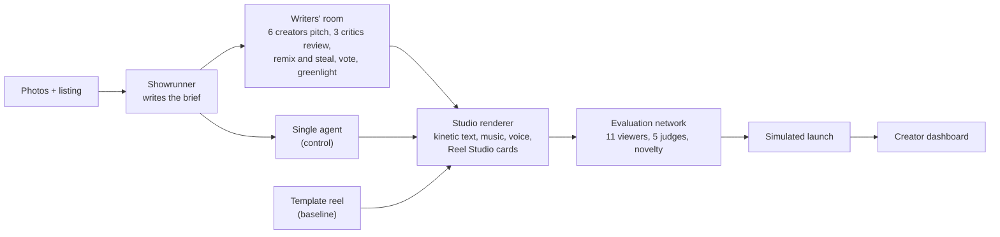
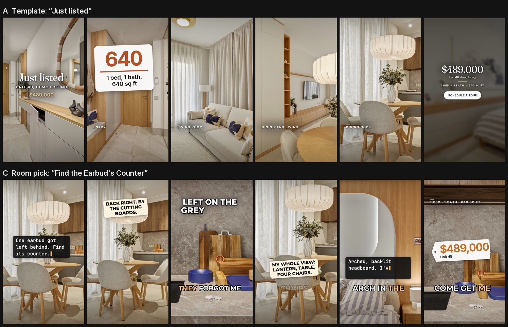

# Creative lab

The creative lab turns a shoot's photos into listing reels a realtor would actually post, and checks whether
they are creative. A writers' room of agents pitches, critiques, remixes and greenlights reel concepts. A
renderer built on Reel Studio's engine turns the finalists into 9:16 videos. An independent network of viewer
and judge agents watches them blind and scores them, and a simulated launch on the creator dashboard shows which
reel would travel further. Every run also includes the conventional template reel and a single-agent control,
so the lab measures what the room adds instead of assuming it.

It needs no AutoHDR data: any shoot with photos works. The demo uses one apartment from the customer dataset
(shoot `64170ca0a0`, eight photos of a one-bedroom) with demo listing values.

## How it works



*The room and the control get the same brief, photos and craft notes; the evaluation never learns which reel
came from where.*

**Writers' room** (`creative/room.py`, `personas.py`, `prompts/`). The showrunner studies every photo and writes a
brief of verified facts and hero features. Six creators with different lenses (Storyteller, Contrarian,
Comedian, Cinematographer, Detail Detective, Trend Scout) each pitch two complete concepts independently: hook,
shots, camera moves, transitions, on-screen text, voiceover, cards, music, ending and post caption. Three critics
review the wall without creator names: the Cliche Hunter, the Fact Checker (every claim against the photos and
the listing, plus fair-housing wording) and The Algorithm (stop power, watch time, loops, shares, and whether a
serious buyer learns what the home is and what it costs). Each creator then revises its strongest concept and
steals a device from two concepts it is dealt, votes for someone else's best, and the showrunner greenlights two
finalists that are original, likely to travel, different from each other and free of truth flags. Concepts and
critiques reach the dashboard as they are made.

**Controls** (`creative/baseline.py`). The template is the reel most listings post: "Just listed", rooms in
showing order with their names, a stats card, "Schedule a tour". The single agent is one conversation with the
same model, brief, photos and craft notes, asked for eight diverse concepts and then for its best.

**Studio renderer** (`creative/render.py`, `studio/`). Python draws every frame and one ffmpeg process encodes
it, as in `reel/`. It adds eight camera moves (punch-ins, tilts for portrait photos), six transitions (whip,
flash, zoom-through), seven kinetic text styles (pop-in words, typewriter, stickers, redaction bars, countdowns),
Reel Studio's caption style for voiceover, seven generated music moods with beat-snapped cuts and drops, eight
synthesized sound effects, macOS voices, and Reel Studio's animation cards (price tag, count-up stat, list,
quote, chat), vendored from reel-studio-app and rendered headless through Playwright's Chromium. Audio is
mastered to -14 LUFS. A 25-second reel renders in 17 to 40 seconds on an Apple M4.

**Evaluation network** (`creative/audience.py`, `judges.py`, `novelty.py`, `evaluate.py`). Reels go out under
shuffled neutral names; no viewer or judge sees a label, kind or id (a test checks every request).
- 11 viewer personas, weighted like a real-estate audience by need and habit (impatient scrollers, first-time
  buyers, local buyers, design fans, investors, relocators and others), watch 12 to 16 timed frames with the
  on-screen text and spoken words, and report when they would scroll away and what they would do.
- 5 expert judges (Amabile's Consensual Assessment Technique) rate each reel on seven dimensions and overall
  creativity, then compare every pair in both orders. Agreement is Kendall's W with tie correction.
- Novelty is computed without a model judge: each on-screen line is embedded (all-MiniLM-L6-v2) and compared
  with a hidden corpus of 195 overused real-estate reel hooks, captions and structures, 172 of them with a cited
  source (`corpus/cliches.json`); the creators never see it. Structure novelty measures distance from the standard
  walkthrough. The creativity map projects every concept and cliche to 2-D.
- A head judge writes the verdict from the numbers and must say so when a creative reel loses or when the
  single agent matches the room.

**Simulated launch** (`creative/simulate.py`). A seeded, staged-distribution model of a short-video feed: a
first wave to a share of followers, then waves sized by completion, shares, saves and comments, with
impressions tilting toward the segments that engaged. Every rate comes from the viewer panel; the constants are
listed in the simulation's notes and shown on the dashboard, which labels the result as a model-based
prediction, not platform data.

## Results

Two full labs on the demo apartment, every phase live, Claude Opus 5.5 for every agent.



*The first lab: the template reel (top) and the room's greenlit "Find the Earbud's Counter" (bottom), a find-it
game built on an earbud case the showrunner spotted on the kitchen counter.*

| | Lab `212903-d13318` | Lab `215529-df468d` |
|---|---|---|
| Template (A): judges' creativity, simulated 48 h views | 2.6, 2,018 | 2.4, 2,015 |
| Room finalist B | "Two Things Out of Place": 6.0, 4,301 | "What You're Not Buying": 6.6, **7,309** |
| Room finalist C | "Find the Earbud's Counter": **6.6**, **6,277** | "The Cabinet Handle Hunt": 6.4, 4,184 |
| Single agent (S) | "The Mirror Has Notes": 5.8, 2,637 | "One Door Left Open": **7.0**, 4,665 |
| Judges' agreement (Kendall's W) | 0.90 (p = 0.004) | 0.81 (p = 0.007) |
| Concept diversity, room / single agent | 0.43 / 0.52 | 0.49 / 0.50 |
| Wall time, cost, model calls | 677 s, $11.31, 173 | 650 s, $10.22, 175 |

- Every creative reel beat the template in both labs: judged creativity 5.8 to 7.0 against 2.4 to 2.6, novelty
  (text and structure) 0.64 to 0.89 against 0.17, and 1.3 to 3.6 times the simulated views.
- The room's best reel travelled furthest in both labs.
- The room did not reliably out-create one strong agent: the single agent won judged creativity in the second
  lab, and its concepts were at least as diverse in both. Both verdicts say so. What the critics visibly add is
  error catching: in the room's test run they flagged a wrong price, a padded storage count and seven concepts
  converging on the same ending, and the remix fixed them. The single agent has no such check.
- In the evaluator's first test, an active local buyer preferred the template (would message the agent: 15
  against 3, "is this a listing or just decor?"). Creative reels now have to land the price and the basics.

The dashboard's demo replay (`?api=mock`) is the first lab, recorded with `scripts/record_creative_demo.py`
(reel B re-rendered after a cosmetic countdown fix; same concept).

Cost per lab is about $10 to $11, most of it the six creators' thinking (about $5 to $6) and the judges (about
$2). Lower `CREATIVE_EFFORT`, fewer creators (`creators` in the options) or a cheaper `AUDIENCE_MODEL` cut it.

## Running it

```bash
uv run shootagent creative <shoot-id>                 # the whole lab, feed printed live (~11 min)
uv run shootagent creative <shoot-id> --resume <lab>  # continue a failed or cancelled lab
uv run shootagent creative-sim <shoot-id> <lab> --followers 20000 --seed 3
uv run python scripts/record_creative_demo.py <shoot-id> <lab>   # make it the dashboard's demo replay
```

In the web app, open a shoot and press **Creative lab**, or go to `#/creator/<shoot-id>`. Endpoints are in
[api.md](api.md#creative-lab). Labs live in `data/shoots/<id>/creative/<lab>/` (`state.json` and `reels/`).

## Limitations

- Every viewer and judge is the same model, so they share its blind spots. They see still frames, not motion,
  and read the music and voice as descriptions.
- The simulator's rates and wave sizes are documented assumptions, not fitted to platform data. Treat its
  numbers as a comparison between reels, not a forecast.
- Two labs on one apartment. Rankings between the creative reels move between runs; the gap to the template
  did not.
- Voices are macOS's built-in ones, without OpenAI or another neural voice. They read as synthetic, so the
  creators are told to lead with on-screen text.
- Novelty depends on the cliche corpus and the structure weights are hand-set.

## Credits

Animation cards and the caption style come from [Reel Studio](https://github.com/AidenJohnston/reel-studio-app)
(MIT, commit 31382f9; `studio/reelstudio/` keeps its license and a notice). Montserrat is under the SIL Open Font
License. The hook rules in `prompts/craft.md` adapt Reel Studio's `writeScript.md`. Sources for the trend notes
and the cliche corpus are cited inside `prompts/trends.md` and `corpus/cliches.json`.
